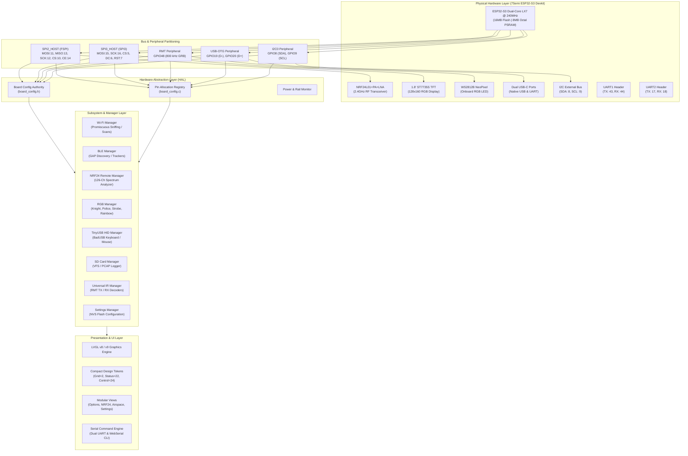
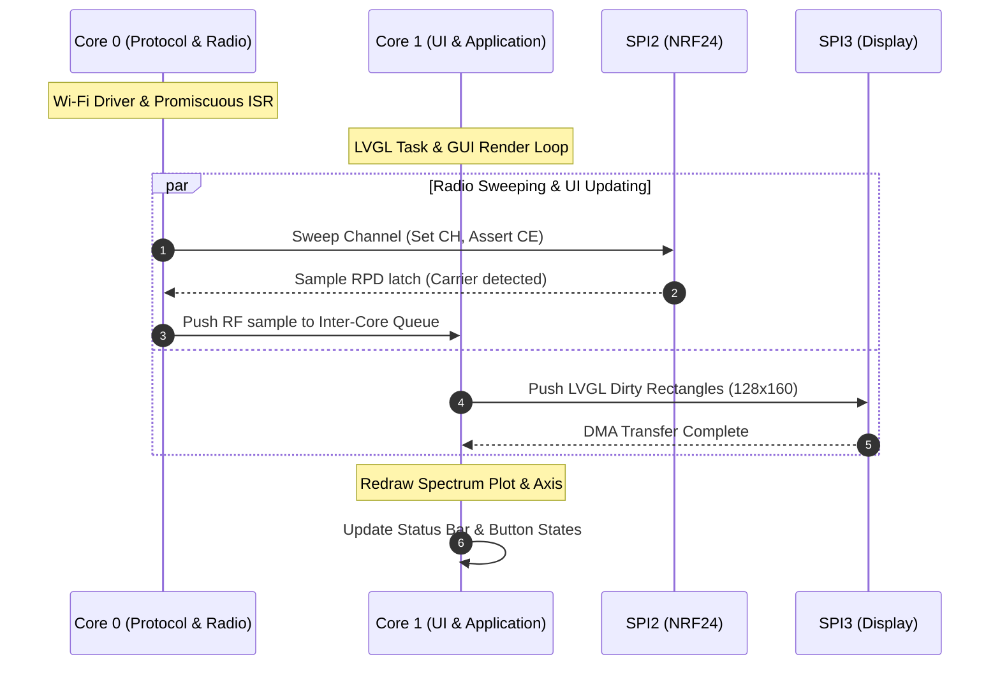
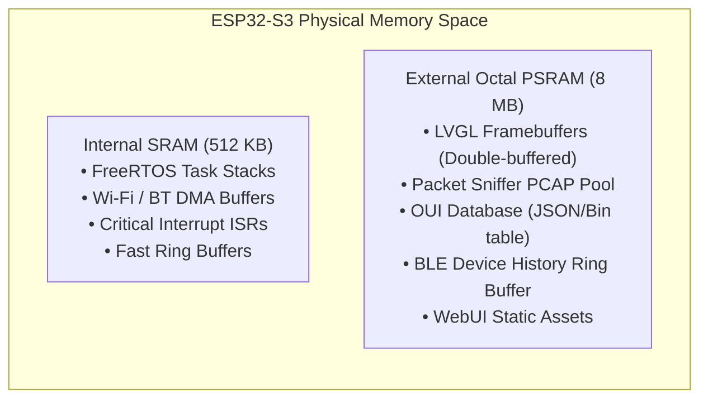
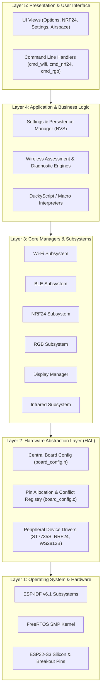

# Master Architecture Specification
## GhostESP God Mode V2 – High-Reliability Embedded Firmware Architecture

**Document Version:** 2.0.0  
**Target Architecture:** Espressif ESP32-S3 (Xtensa Dual-Core LX7 @ 240 MHz, 16 MB Flash, 8 MB Octal PSRAM)  
**Status:** Approved Architecture Baseline  
**Date:** November 24, 2026  

---

## 1. Architectural Overview & Design Philosophy

GhostESP God Mode V2 is engineered around four core tenets:
1. **Decoupled Hardware Abstraction:** No application manager or UI screen touches raw GPIO registers directly. All peripherals access pins via a centralized Board Configuration & Pin Allocation Registry.
2. **Dedicated Bus Separation:** High-frequency SPI traffic (RF spectrum scanning) and visual SPI traffic (display frame rendering) reside on independent physical SPI controllers (`SPI2_HOST` and `SPI3_HOST`), eliminating bus contention, mutex jitter, and visual stutter.
3. **Determinism & Memory Hierarchy:** Heap-heavy buffers (PCAP capture pools, BLE discovery tables, font glyph caches) are allocated dynamically in external 8 MB Octal PSRAM, preserving precious internal SRAM for high-speed FreeRTOS task stacks and ISR buffers.
4. **Resilient Failure Handling:** Missing or unpowered hardware modules degrade gracefully with warning logs instead of inducing kernel panics (`LoadProhibited` / `Guru Meditation`).

---

## 2. System Architecture Block Diagram

---

## 3. Bus Architecture & Pin Allocation Table

GhostESP God Mode V2 maintains strict bus isolation across the 7Semi ESP32-S3 board:

| Subsystem | Bus / Host | MOSI / SDA / TX | MISO / SCL / RX | Clock / SCK | Chip Select (CS) | Extra Control |
| :--- | :---: | :---: | :---: | :---: | :---: | :---: |
| **NRF24 RF Transceiver** | `SPI2_HOST` | GPIO 11 | GPIO 13 | GPIO 12 | GPIO 10 | CE: GPIO 14 |
| **ST7735S 128×160 TFT** | `SPI3_HOST` | GPIO 15 | NC (N/A) | GPIO 16 | GPIO 5 | DC: 6, RST: 7, BCKL: 3.3V |
| **Primary I2C Bus** | `I2C_NUM_0` | GPIO 8 (SDA) | GPIO 9 (SCL) | Up to 400 kHz | N/A | Ext 4.7kΩ Pull-ups |
| **UART1 Auxiliary** | `UART_NUM_1`| GPIO 43 (TX) | GPIO 44 (RX) | N/A | N/A | Up to 921600 baud |
| **UART2 Expansion** | `UART_NUM_2`| GPIO 17 (TX) | GPIO 18 (RX) | N/A | N/A | Up to 115200 baud |
| **Native USB Stack** | `USB-OTG` | GPIO 19 (D-) | GPIO 20 (D+) | N/A | N/A | Reserved for BadUSB |
| **WS2812B RGB Indicator**| `RMT_CH0` | GPIO 48 | N/A | 800 kHz | N/A | Built-in NeoPixel |

### Strict Hardware Restriction Rules:
1. **Octal PSRAM Integrity:** GPIO 35, 36, 37, and 38 connect internally to the 8 MB Octal PSRAM. Never assign, configure, or alter these pins.
2. **Native USB Protection:** GPIO 19 and 20 are routed directly to the native USB-C port. Any general-purpose output toggle on these pins terminates USB communication and brick/reboot the device.
3. **Input-Only Constraint:** GPIO 46 is physically an input-only pin without internal pull-ups or output drivers. It must never be configured as an output.
4. **Boot & Strapping Safety:** GPIO 0 (Boot), GPIO 3, and GPIO 45 are strapping pins. They must not be held in contradictory logic states during power-up or system reset.

---

## 4. FreeRTOS Task Architecture & Concurrency Model

GhostESP God Mode V2 partitions execution across both Xtensa LX7 cores:

### FreeRTOS Task Allocation Table:

| Task Name | Core Affinity | Priority | Stack Size | Function / Ownership |
| :--- | :---: | :---: | :---: | :--- |
| **`lvgl_task`** | Core 1 | 5 | 8192 bytes | LVGL display rendering, touch/key input polling, view lifecycle. |
| **`serial_cli_task`** | Core 1 | 3 | 4096 bytes | Serial command parser, line editor, and terminal output dispatcher. |
| **`wifi_scan_task`** | Core 0 | 4 | 4096 bytes | 802.11 b/g/n active scanning, beacon parsing, and RSSI tracking. |
| **`nrf24_sweep_task`**| Core 0 | 4 | 4096 bytes | Dedicated 126-channel spectrum sweep and RPD signal acquisition on SPI2. |
| **`rgb_anim_task`** | Core 1 | 2 | 4096 bytes | WS2812B animation engine (Knight Rider, Police, Strobe, Rainbow). |
| **`async_pcap_task`** | Core 0 | 3 | 4096 bytes | Asynchronous disk writing of captured frames to SD Card or SPIFFS. |

---

## 5. Memory Management & Allocation Strategy

### Memory Rules:
1. **Dynamic PSRAM Allocation:** Large structures ($\ge 4\text{ KB}$) that do not require DMA access must use `heap_caps_malloc(size, MALLOC_CAP_SPIRAM)`.
2. **DMA-Capable Internal Allocations:** SPI transmit buffers and RMT descriptors must be allocated using `heap_caps_malloc(size, MALLOC_CAP_DMA | MALLOC_CAP_INTERNAL)`.
3. **Internal SRAM Watermark:** The system must maintain at least 64 KB of free internal SRAM at all times to prevent Wi-Fi stack starvation.

---

## 6. Software Layered Architecture

---

## 7. Error Handling & Architectural Fault Tolerance

1. **Hardware Absence Detection:**
   During boot, every driver attempts a non-destructive handshake (e.g., NRF24 reads `CONFIG` register `0x00`, Display issues software reset `0x01`). If the read returns all 0x00 or all 0xFF, the driver marks the device as `UNAVAILABLE` and continues booting.
2. **Headless & Screen Fallback:**
   If the screen fails to initialize or is unconfigured, GUI calls are short-circuited via `display_manager_is_available()` without attempting to dereference `lv_disp_get_default()`, completely preventing null-pointer crashes.
3. **Timeout Clamping:**
   All inter-task synchronization primitives (mutexes, semaphores, queues) must use bounded timeouts (maximum 1000 ms) instead of `portMAX_DELAY` to prevent deadlock conditions.
