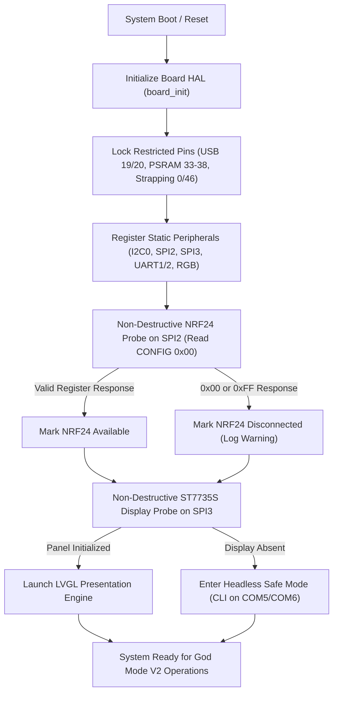

# Hardware Compatibility & Engineering Assessment Specification
## GhostESP God Mode V2 – 7Semi ESP32-S3-WROOM-1-N16R8 Target Authority

**Document Version:** 2.0.0  
**Status:** Approved Hardware Baseline  
**Target Platform:** 7Semi ESP32-S3-WROOM-1-N16R8 (Dual USB-C, 16 MB Flash DIO, 8 MB Octal PSRAM AP_3v3)  
**Author:** ESP32 Hardware Engineering & Pinout Architect (Agent 2)  
**Date:** November 24, 2026  

---

## 1. Executive Summary & Hardware Overview

This document establishes the official electrical, thermal, power distribution, and hardware interface authority for **GhostESP God Mode V2** deployed on the **7Semi ESP32-S3-WROOM-1-N16R8** development board. 

The 7Semi ESP32-S3 devkit is a high-density, dual-core embedded research platform featuring dual USB-C ports, 16 MB of high-speed SPI Flash, and 8 MB of Octal SPI PSRAM. While providing immense compute and memory headroom, this board imposes strict silicon-level electrical and pin routing constraints that differ radically from legacy ESP32 (WROOM-32) and generic ESP32-S3 development boards.

```
 +---------------------------------------------------------------------------------+
 |                    7Semi ESP32-S3-WROOM-1-N16R8 ARCHITECTURE                   |
 |                                                                                 |
 |   +-------------------------+                     +-------------------------+   |
 |   |   Primary USB-C (COM5)  |                     |  Secondary USB-C (COM6) |   |
 |   | Native USB-Serial / JTAG|                     |   CP210x USB-to-UART    |   |
 |   | GPIO19 (D-), GPIO20 (D+)|                     |   GPIO43 (TX), GPIO44(RX|   |
 |   +------------+------------+                     +------------+------------+   |
 |                |                                               |                |
 |                +--------------------+     +--------------------+                |
 |                                     |     |                                     |
 |                                  +--v-----v--+                                  |
 |                                  |  5V (VIN) | Dual-Diode OR-ing Bus            |
 |                                  +-----+-----+                                  |
 |                                        |                                        |
 |                       +----------------+----------------+                       |
 |                       |                                 |                       |
 |                 +-----v-----+                     +-----v-----+                 |
 |                 |Onboard LDO|                     |Ext NRF24  |                 |
 |                 | (5V->3.3V)|                     |Adapter LDO|                 |
 |                 | Max 500mA |                     | Max 800mA |                 |
 |                 +-----+-----+                     +-----+-----+                 |
 |                       |                                 |                       |
 |          +------------+------------+                    |                       |
 |          |            |            |                    |                       |
 |    +-----v-----+ +----v----+ +-----v-----+        +-----v-----+                 |
 |    | ESP32-S3  | |ST7735S  | |  WS2812B  |        | NRF24L01+ |                 |
 |    | CPU/Flash/| | TFT VCC | |  RGB LED  |        | +PA+LNA   |                 |
 |    | Octal RAM | | Logic   | | (GPIO 48) |        | RF Engine |                 |
 |    +-----------+ +---------+ +-----------+        +-----------+                 |
 +---------------------------------------------------------------------------------+
```

---

## 2. Microcontroller Subsystem & Memory Topology

### 2.1 Silicon Core Specifications
- **Microcontroller:** Espressif Systems ESP32-S3 (Xtensa® 32-bit LX7 dual-core, revision v0.2).
- **Core Clock Frequency:** 240 MHz (Core 0: Network & RF Protocol Engine; Core 1: LVGL Presentation & CLI Dispatcher).
- **Internal SRAM:** 512 KB SRAM (384 KB available for L1 data cache and FreeRTOS heaps; 64 KB reserved for RTC memory).
- **Low-Power Coprocessor:** Ultra-Low-Power (ULP) RISC-V core.

### 2.2 Flash & Memory Architecture
- **Embedded Flash:** 16 MB NOR Flash connected via internal Quad/Dual SPI (`DIO` mode @ 80 MHz). Flash pins are routed internally to GPIO 27, 28, 29, 30, 31, and 32.
- **External PSRAM:** 8 MB Octal SPI PSRAM (`AP_3v3` operating at 80 MHz DDR).
  - **Critical Octal Bus Warning:** The Octal PSRAM occupies a dedicated high-speed bus routed internally to **GPIO 33, GPIO 34, GPIO 35, GPIO 36, GPIO 37, and GPIO 38**.
  - **Silicon Restriction:** Even though GPIO 38 is physically broken out on the 7Semi right header pin, it is electrically tied to the internal PSRAM data lines. **Any electrical connection, toggle, or software configuration of GPIO 35–38 will immediately corrupt the PSRAM memory bus and trigger a fatal kernel panic (`StoreProhibited` / Cache Error).**

---

## 3. Power Distribution, Rail Analysis & Peak Current Budgets

### 3.1 Power Rail Domains
The 7Semi development board implements two distinct voltage domains:

1. **5V Rail (`VBUS` / `VIN`):**
   - Supplied via either the Primary USB-C (Native) or Secondary USB-C (CP210x UART) connector.
   - Protected by dual Schottky isolation diodes (B5819W / SS14 forward drop $\approx 0.35\text{V}$) to prevent cross-charging or ground loops when both USB cables are connected simultaneously.
   - Delivers up to 500 mA from a standard USB 2.0 root hub, or up to 1.5 A – 3.0 A when powered from a USB-C wall adapter or powered hub.

2. **3.3V Logic Rail (`VDD_3V3`):**
   - Generated by an onboard low-dropout linear regulator (ME6211 / AP2112K series) stepping 5V down to 3.3V with a maximum rated output current of **500 mA** (absolute maximum limit: 600 mA).
   - Powers the ESP32-S3 SoC, internal flash memory, 8 MB Octal PSRAM die, and the onboard WS2812B NeoPixel RGB LED.

### 3.2 System Power Budget & Current Draw Analysis

| Subsystem / Component | Operating Voltage | Typical Idle Current | Peak Operating Current | Peak Duration / Nature |
| :--- | :---: | :---: | :---: | :--- |
| **ESP32-S3 CPU (Dual Core @ 240 MHz)** | 3.3V | 45 mA | 120 mA | Continuous compute load |
| **16 MB Flash + 8 MB Octal PSRAM** | 3.3V | 15 mA | 45 mA | Memory bursts during PCAP / LVGL DMA |
| **Wi-Fi Subsystem (Active Promiscuous Sniffing)** | 3.3V | 85 mA | 115 mA | Continuous receiver sampling |
| **Wi-Fi Subsystem (802.11b TX @ 20 dBm)** | 3.3V | — | **380 mA** | 1–5 ms transient transmission bursts |
| **Bluetooth 5.0 (BLE GAP Scanner)** | 3.3V | 80 mA | 130 mA | Periodic active scan windows |
| **WS2812B RGB NeoPixel (GPIO 48)** | 3.3V | 1 mA | **55 mA** | Full 100% White (R=255, G=255, B=255) |
| **ST7735S Display Logic (VCC)** | 3.3V | 2 mA | 8 mA | Frame transfer logic |
| **ST7735S Display Backlight (LED to 3.3V)** | 3.3V | — | **45 mA** | Continuous white LED backlight |
| **TOTAL (Onboard 3.3V Rail Peak Load)** | **3.3V** | **~228 mA** | **~485 mA** | **Exhausts onboard LDO capacity!** |

### 3.3 NRF24L01+PA+LNA Transceiver Power Surge Analysis

The **NRF24L01+PA+LNA** module incorporates an RFX2401C / SE2431L RF Front-End IC integrating a Power Amplifier (PA) delivering up to **+20 dBm (100 mW)** transmit power and a Low-Noise Amplifier (LNA) with +10 dB gain.

```
       NRF24L01+PA+LNA Current Profile During Transmission Burst
  Current
    (mA)
    250 +-------------------------+-------------------------+
        |                         |#### TRANSMISSION BURST  |
    200 |                         |#### +20 dBm (220-250mA) |
        |                         |####                     |
    150 |                         |####                     |
        |                         |####                     |
    100 |                         |####                     |
        |  IDLE / RX (~18mA)      |####                     |
     50 |-------------------------+####---------------------+
        |                                                   |
      0 +---------------------------------------------------+--> Time (ms)
```

- **Quiescent / RX Mode:** Draws approximately 13.5 mA to 22 mA.
- **Active Transmission Burst (+20 dBm):** Peak current surges to **215 mA – 250 mA** with extremely fast rise times ($di/dt > 50\text{ mA}/\mu\text{s}$).

> [!CAUTION]
> **Catastrophic Power Hazard:** Connecting the NRF24L01+PA+LNA directly to the 7Semi board's 3.3V pin will combine the 485 mA onboard peak load with the 250 mA NRF24 burst load, demanding **735 mA** from a 500 mA LDO. This immediately pulls the 3.3V rail down below the ESP32-S3 brownout trip point ($2.80\text{V}$), causing an instantaneous chip reset:
> `Guru Meditation Error: Core 0 panic'ed (Brownout detector was triggered)`

### 3.4 Mandatory Power Architecture Solution

1. **Dedicated AMS1117-3.3V Adapter Board:**
   The NRF24L01+PA+LNA transceiver **must be seated in an 8-pin socket adapter board** equipped with an onboard AMS1117-3.3 low-dropout regulator and local filtering capacitors.
2. **5V (VIN) Connection:**
   The socket adapter VCC pin must connect exclusively to the **5V (VIN)** header pin (Left Header, Pin 21), tapping directly into the 5V USB bus. The AMS1117 steps 5V down to 3.3V dedicated entirely to the radio, providing up to 800 mA continuous headroom and completely isolating RF switching transients from the ESP32-S3 CPU and PSRAM rails.
3. **Local Transceiver Decoupling:**
   Even with the adapter board, high-speed radio bursts benefit greatly from a **10 µF low-ESR tantalum capacitor in parallel with a 100 nF ceramic capacitor** soldered directly across the NRF24 module's VCC and GND pins to absorb transient current steps.

---

## 4. Electrical Requirements, Signal Integrity & Level Shifting

### 4.1 Logic Level Compatibility Matrix

| Interface / Signal | ESP32-S3 Voltage | Peripheral Voltage | Compatible Directly? | Electrical Requirement / Protection |
| :--- | :---: | :---: | :---: | :--- |
| **SPI2 (NRF24: SCK, MOSI, CSN, CE)** | 3.3V CMOS | 3.3V VCC (5V Tol. Inputs) | **YES** | Direct connection. NRF24 SPI inputs accept 3.3V CMOS with high margin ($V_{IH} = 2.0\text{V}$). |
| **SPI2 (NRF24: MISO)** | 3.3V Input | 3.3V Output | **YES** | Direct connection. NRF24 drives MISO at 3.3V logic level. |
| **SPI3 (Display: SCK, MOSI, CS, DC, RST)** | 3.3V CMOS | 3.3V Logic | **YES** | Direct connection. 1.8" TFT onboard regulator steps 5V to 3.3V; ST7735S logic is 3.3V. |
| **I2C Bus (GPIO 8 SDA, GPIO 9 SCL)** | 3.3V Open-Drain | 3.3V Sensors | **YES (with pull-ups)** | **Mandatory 4.7 kΩ pull-up resistors to 3.3V.** ESP32-S3 internal pull-ups (~45 kΩ) are too weak for 400 kHz fast-mode. |
| **I2C Bus (5V Sensors / Legacy ICs)** | 3.3V Open-Drain | 5.0V Sensors | **NO** | **Active bi-directional level shifter mandatory** (e.g. PCA9306 or BSS138 circuit). 5V injection will destroy GPIO8/9. |
| **UART1 (GPIO 43 TX, GPIO 44 RX)** | 3.3V LVTTL | 3.3V Serial | **YES** | Direct connection to 3.3V GPS / LTE modems. |
| **UART2 (GPIO 17 TX, GPIO 18 RX)** | 3.3V LVTTL | 3.3V Serial | **YES** | Direct connection to expansion peripherals. |
| **Native USB (GPIO 19 D-, GPIO 20 D+)** | 3.3V USB-FS | 3.3V USB-FS | **RESTRICTED** | Direct-wired to Primary USB-C port with internal transceivers. **Never connect external wires!** |
| **WS2812B NeoPixel (GPIO 48)** | 3.3V RMT Output | 3.3V VDD | **YES** | Onboard LED is factory-wired to 3.3V rail. High-speed RMT timings tuned for 800 kHz GRB. |

### 4.2 Absolute Maximum Ratings & GPIO Drive Limits
- **Maximum GPIO Pin Current:** 40 mA absolute maximum (Recommended operating limit: $\le 20\text{ mA}$ per pin; total sum across all GPIOs $\le 120\text{ mA}$).
- **High-Current Loads (e.g. IR LEDs):** High-power infrared emitters (940 nm) requiring 50–100 mA bursts **must never be driven directly by GPIO pins**. An external N-channel MOSFET (e.g. 2N7002 or AO3400A) or NPN bipolar transistor (e.g. 2N2222) with a gate/base resistor is required.
- **5V Tolerance:** **ESP32-S3 GPIO pins are NOT 5V tolerant.** Connecting any 5V signal directly to an unbuffered GPIO pin triggers substrate latch-up or permanent gate oxide puncture.

---

## 5. Legacy GhostESP vs 7Semi God Mode V2 Architectural Mapping

Legacy GhostESP releases were architected around the original ESP32-D0WDQ6 (classic ESP32 WROOM-32) or specialized hardware form factors (e.g. M5Stack Cardputer, Marauder v4/v6). Direct application of legacy configurations to the 7Semi ESP32-S3 board results in catastrophic failures.

### 5.1 Comprehensive Architectural Divergence Matrix

| Hardware Feature / Peripheral | Legacy GhostESP (Generic ESP32) | 7Semi ESP32-S3 (God Mode V2) | Failure Mode on 7Semi if Legacy Config is Used | God Mode V2 Architectural Resolution |
| :--- | :--- | :--- | :--- | :--- |
| **Primary I2C Bus** | `SDA=GPIO21`, `SCL=GPIO22` or `SDA=19, SCL=20` | `SDA=GPIO8`, `SCL=GPIO9` | **Fatal USB Crash:** Using GPIO 19/20 terminates Native USB CDC/JTAG communication and bricks COM5 serial CLI. GPIO 22 does not exist on 7Semi header. | Routed cleanly to **GPIO 8 & GPIO 9** with dedicated 4.7 kΩ pull-ups. GPIO 19/20 locked in HAL. |
| **External RF (NRF24) Bus** | Shared VSPI (`SCK=18, MISO=19, MOSI=23, CS=5`) | Dedicated `SPI2_HOST` (`MOSI=11, MISO=13, SCK=12, CS=10, CE=14`) | **Bus Collisions & Disconnects:** GPIO 19 kills Native USB. GPIO 23 does not exist on 7Semi breakout. Sharing SPI with display causes severe frame jitter and dropped RF sweeps. | Dedicated **`SPI2_HOST`** on continuous 7-pin left header block (GPIO 10–14). Fully isolated from display and USB. |
| **TFT Display Interface** | Shared VSPI or HSPI (`CS=15, DC=2, RST=4, MOSI=23, SCK=18`) | Dedicated `SPI3_HOST` (`MOSI=15, SCK=16, CS=5, DC=6, RST=7`) | **Bus Starvation:** Sharing SPI bus with NRF24 continuous 126-channel spectrum sweep causes FreeRTOS mutex deadlocks and display flickering. | Dedicated **`SPI3_HOST`** for ST7735S display. Independent DMA channels eliminate all bus contention. |
| **Octal PSRAM Integrity** | GPIO 35–38 used as ADC input pins or button lines | Strictly reserved internal Octal PSRAM bus (`GPIO33–38`) | **Immediate Kernel Panic:** Toggling GPIO 35, 36, 37, or 38 corrupts the high-speed 80 MHz Octal PSRAM bus, causing instant cache error panics (`LoadProhibited`). | GPIO 33–38 designated **`PIN_FLAG_PSRAM_BUS`** in HAL; all external allocation attempts are blocked and logged. |
| **Serial Telemetry / Modems** | `UART0` default only (`TX=1, RX=3`) | `UART1 (TX=43, RX=44)` & `UART2 (TX=17, RX=18)` | Pin conflict on standard UART pins. ESP32-S3 routes default UART0 to GPIO 43/44. | Dedicated **UART1 (43/44)** and **UART2 (17/18)** interfaces mapped to physical headers for GPS and telemetry. |
| **Onboard RGB Indicator** | Standard GPIO (e.g. GPIO 2 or GPIO 4) | High-precision RMT NeoPixel on `GPIO48` | Single-pin toggling fails; WS2812B requires exact 800 kHz GRB pulse-width protocol. | Dedicated RMT driver on **GPIO 48** with gamma correction and real-time brightness scaling. |
| **Input-Only Pins** | Classic ESP32: GPIO 34, 35, 36, 39 are input-only | ESP32-S3: **GPIO 46 is input-only**; GPIO 34–38 are PSRAM bus | Attempting to configure GPIO 46 as an output fails silently or produces invalid drive states. | HAL enforces **`PIN_FLAG_INPUT_ONLY`** on GPIO 46; output driver configuration rejected. |

---

## 6. Hardware Verification & Diagnostic Protocol

To ensure 100% electrical integrity, every 7Semi ESP32-S3 deployment must adhere to the following startup validation procedure:



1. **Non-Destructive Peripheral Probing:**
   - Drivers must never assume hardware presence. The NRF24 driver reads the `CONFIG` register (`0x00`) over SPI2; if the return value is `0x00` (shorted/unpowered) or `0xFF` (floating/disconnected), the module is marked `HW_PRESENCE_DISCONNECTED`.
   - The display manager checks for successful initialization; if unpowered, it enters headless mode without calling LVGL graphics APIs, preventing null-pointer panics (`LoadProhibited`).
2. **Graceful Degradation:**
   - Disconnected hardware must never trigger FreeRTOS task crashes or watchdog reboots. The system logs informative status banners over serial and continues operating available subsystems.

---

## 7. Migration Guidelines for Firmware Developers

When adding or modifying features in GhostESP God Mode V2:
1. **Never Call `gpio_set_direction()` or `gpio_set_level()` Directly in Application Code:**
   Always register pins through the centralized Board Configuration Registry via `board_register_pin()`.
2. **Never Hardcode GPIO Numbers in Header Files:**
   Use the canonical macros defined in `include/hardware/board_config.h` (`BOARD_PIN_*`).
3. **Always Check Peripheral Availability Before Use:**
   Query `board_get_periph_presence(PERIPH_ID_*)` before launching high-power scanning tasks or attempting bus transactions.
4. **Adhere Strictly to the Power Rules:**
   Never power external RF modules or motor/haptic drivers from the 3.3V rail. Always utilize external LDO regulators powered from the 5V (VIN) rail.
