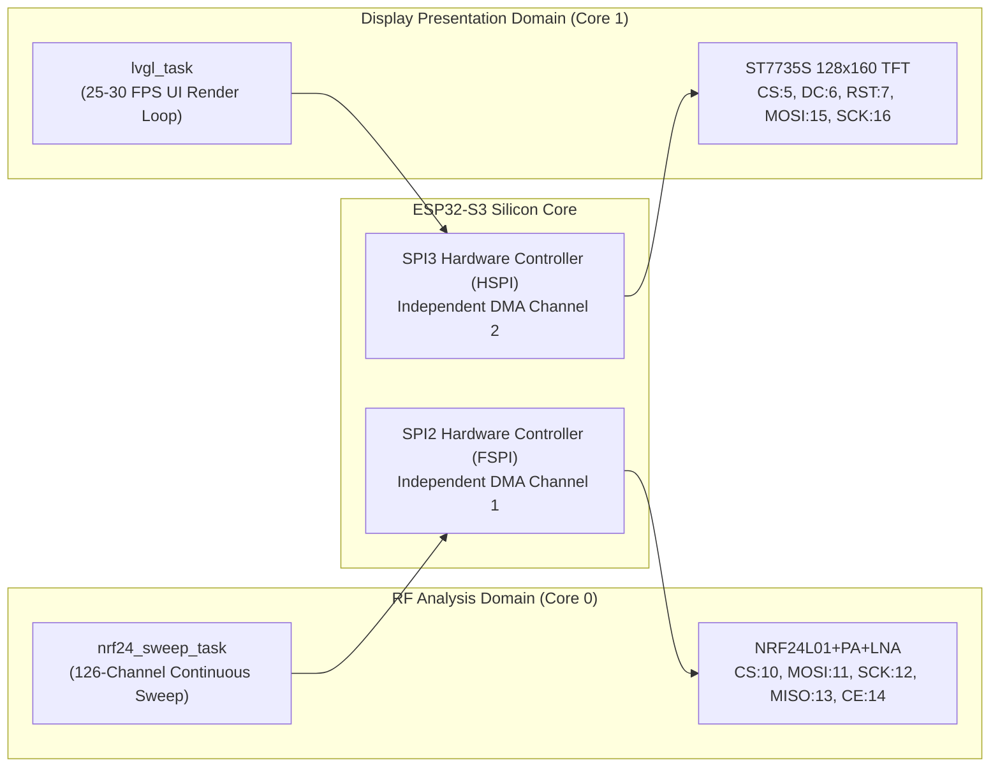

# Exhaustive Pin Configuration & Hardware Allocation Specification
## GhostESP God Mode V2 – 7Semi ESP32-S3-WROOM-1-N16R8 Authority

**Document Version:** 2.0.0  
**Status:** Approved Pinout Authority  
**Target Platform:** 7Semi ESP32-S3-WROOM-1-N16R8 (Dual USB-C, 16 MB Flash, 8 MB Octal PSRAM)  
**Author:** ESP32 Hardware Engineering & Pinout Architect (Agent 2)  
**Date:** November 24, 2026  

---

## 1. Executive Summary

This specification establishes the authoritative, conflict-free pin configuration and hardware allocation matrix for the **7Semi ESP32-S3-WROOM-1-N16R8** development board under **GhostESP God Mode V2**.

Every physical GPIO pin on the ESP32-S3 (GPIO 0 through GPIO 48) is audited, categorized, and assigned to dedicated hardware subsystems. Strict bus isolation is enforced across all communication channels to guarantee zero bus contention, deterministic execution, and complete protection of sensitive internal memory and communication buses.

```
                  7Semi ESP32-S3 PHYSICAL PINOUT & BUS PARTITION
                                 +---------------+
                      5V (VIN) --| 1          22 |-- GND
                          3.3V --| 2          21 |-- 5V (VIN / NRF24 VCC)
              Display CS (IO5) --| 3          20 |-- NRF24 CE (IO14)
              Display DC (IO6) --| 4          19 |-- NRF24 MISO (IO13)
             Display RST (IO7) --| 5          18 |-- NRF24 SCK (IO12)
            Display MOSI (IO15)--| 6          17 |-- NRF24 MOSI (IO11)
             Display SCK (IO16)--| 7          16 |-- NRF24 CSN (IO10)
                UART2 TX (IO17)--| 8          15 |-- I2C SCL (IO9)
                UART2 RX (IO18)--| 9          14 |-- Strapping (IO3)
                 I2C SDA (IO8) --| 10         13 |-- Available / SD CS (IO4)
                        ...    --| 11         12 |-- ...
                                 +---------------+
                                   LEFT HEADER
                                 +---------------+
                  SDMMC CLK (IO1)--| 1          16 |-- GND
                  SDMMC CMD (IO2)--| 2          15 |-- 3.3V
                     JTAG (IO42) --| 3          14 |-- ...
                     JTAG (IO41) --| 4          13 |-- ...
                     JTAG (IO40) --| 5          12 |-- ...
                     JTAG (IO39) --| 6          11 |-- ...
             FORBIDDEN PSRAM(IO38)-| 7          10 |-- ...
                RTC_INT / Aux(IO21)-| 8          9 |-- Aux / SD MISO (IO47)
                                 +---------------+
                                  RIGHT HEADER
```

---

## 2. Exhaustive Pin Allocation Matrix (GPIO 0 – GPIO 48)

The table below catalogs all 49 GPIO channels on the ESP32-S3 silicon, cross-referenced with the 7Semi development board breakout headers, physical direction, constraints, and assigned God Mode V2 functions:

| GPIO | Physical Location | Primary God Mode V2 Function | Direction | Silicon / Electrical Constraints | Allocation State |
| :---: | :--- | :--- | :---: | :--- | :---: |
| **0** | Onboard Button / Left Pin | **BOOT Mode / User Button** | Input | Strapping pin. High for SPI boot; Low for ROM download. Weak internal pull-up. | **System Locked** |
| **1** | Right Header (Pin 1) | **SD Card CLK (SDMMC / SPI)** | Output | Free general GPIO. ADC1_CH0 / Touch 1. High-speed clock line. | **Reserved (SD Card)** |
| **2** | Right Header (Pin 2) | **SD Card CMD / MOSI** | Bi-dir / Out | Free general GPIO. ADC1_CH1 / Touch 2. Strapping pin on select packages. | **Reserved (SD Card)** |
| **3** | Left Header (Pin 10) | **Strapping / Aux Input** | Input | Strapping pin (JTAG / VDD_SPI). Avoid pulling low at boot. | **Caution / Strapping** |
| **4** | Left Header (Pin 1) | **SD Card CS / SDMMC D0** | Output / Bi-dir | Free general GPIO. ADC1_CH3 / Touch 4. Ideal Chip Select line. | **Reserved (SD Card)** |
| **5** | Left Header (Pin 3) | **ST7735S Display CS** | Output | Dedicated to `SPI3_HOST` display chip select. Active Low. | **Dedicated (Display)** |
| **6** | Left Header (Pin 4) | **ST7735S Display DC / A0** | Output | Dedicated to `SPI3_HOST` Data/Command toggle line. | **Dedicated (Display)** |
| **7** | Left Header (Pin 5) | **ST7735S Display Reset (RST)** | Output | Dedicated to ST7735S hardware reset line. Active Low. | **Dedicated (Display)** |
| **8** | Left Header (Pin 9) | **Primary I2C SDA** | Bi-dir (OD) | Open-drain. Requires external 4.7 kΩ pull-up to 3.3V. | **Dedicated (I2C0)** |
| **9** | Left Header (Pin 11) | **Primary I2C SCL** | Output (OD) | Open-drain. Requires external 4.7 kΩ pull-up to 3.3V. Up to 400 kHz. | **Dedicated (I2C0)** |
| **10** | Left Header (Pin 16) | **NRF24L01+ CSN (Chip Select)** | Output | Dedicated to `SPI2_HOST` NRF24 SPI Chip Select. Active Low. | **Dedicated (NRF24)** |
| **11** | Left Header (Pin 17) | **NRF24L01+ MOSI** | Output | Dedicated to `SPI2_HOST` master out data line. 8 MHz clock. | **Dedicated (NRF24)** |
| **12** | Left Header (Pin 18) | **NRF24L01+ SCK** | Output | Dedicated to `SPI2_HOST` master clock line. | **Dedicated (NRF24)** |
| **13** | Left Header (Pin 19) | **NRF24L01+ MISO** | Input | Dedicated to `SPI2_HOST` master in data line. | **Dedicated (NRF24)** |
| **14** | Left Header (Pin 20) | **NRF24L01+ CE (Chip Enable)** | Output | Dedicated to NRF24 RX/TX state toggle. Asserted during dwell. | **Dedicated (NRF24)** |
| **15** | Left Header (Pin 6) | **ST7735S Display MOSI / SDA** | Output | Dedicated to `SPI3_HOST` display serial data in. | **Dedicated (Display)** |
| **16** | Left Header (Pin 7) | **ST7735S Display SCK / SCL** | Output | Dedicated to `SPI3_HOST` display clock line (20–40 MHz). | **Dedicated (Display)** |
| **17** | Left Header (Pin 8) | **UART2 TX** | Output | Auxiliary serial telemetry / expansion transmit line. | **Dedicated (UART2)** |
| **18** | Left Header (Pin 9) | **UART2 RX** | Input | Auxiliary serial telemetry / expansion receive line. | **Dedicated (UART2)** |
| **19** | Onboard Primary USB-C | **Native USB D-** | Bi-dir | **RESTRICTED:** Hardwired to Native USB-OTG PHY. Never reassign! | **System Locked (USB)** |
| **20** | Onboard Primary USB-C | **Native USB D+** | Bi-dir | **RESTRICTED:** Hardwired to Native USB-OTG PHY. Never reassign! | **System Locked (USB)** |
| **21** | Right Header (Pin 8) | **RTC_INT / Aux Interrupt** | Input | External RTC interrupt / general-purpose wake-up pin. | **Available / Aux** |
| **22–25** | Unrouted on Module | *Not Connected* | N/A | Not bonded or unrouted on ESP32-S3-WROOM-1 QFN56 package. | **Unbonded** |
| **26** | Internal Module | *Not Connected* | N/A | Reserved internal line. | **Unbonded** |
| **27–32** | Internal Flash Bus | **16 MB SPI Flash (`DIO`)** | Bi-dir | **RESTRICTED:** Hardwired to 16 MB NOR Flash memory die. | **System Locked (Flash)**|
| **33–37** | Internal PSRAM Bus | **8 MB Octal PSRAM Bus** | Bi-dir | **STRICTLY FORBIDDEN:** High-speed 80 MHz DDR Octal PSRAM data bus. | **System Locked (PSRAM)**|
| **38** | Right Header (Pin 7) | **Octal PSRAM Bus Tap** | Bi-dir | **STRICTLY FORBIDDEN:** Electrically tied to internal PSRAM DQS/CLK. | **FORBIDDEN (PSRAM)** |
| **39** | Right Header (Pin 6) | **JTAG MTCK / Aux GPIO** | Input | Hardware JTAG Clock line. Free for GPIO if JTAG disabled. | **JTAG / Aux** |
| **40** | Right Header (Pin 5) | **JTAG MTDO / Aux GPIO** | Output | Hardware JTAG Data Output line. Free for GPIO if JTAG disabled. | **JTAG / Aux** |
| **41** | Right Header (Pin 4) | **JTAG MTDI / Aux GPIO** | Input | Hardware JTAG Data Input line. Free for GPIO if JTAG disabled. | **JTAG / Aux** |
| **42** | Right Header (Pin 3) | **JTAG MTMS / Aux GPIO** | Input | Hardware JTAG Mode Select line. Free for GPIO if JTAG disabled. | **JTAG / Aux** |
| **43** | Onboard CP210x / Header | **UART0 / UART1 TX** | Output | Default hardware serial console (COM6) / auxiliary telemetry. | **Dedicated (UART1)** |
| **44** | Onboard CP210x / Header | **UART0 / UART1 RX** | Input | Default hardware serial console (COM6) / auxiliary telemetry. | **Dedicated (UART1)** |
| **45** | Left Header (Near Bottom)| **Strapping (VDD_SPI)** | Input | Strapping pin. Configures internal SPI voltage. Must remain High at boot. | **Caution / Strapping** |
| **46** | Left Header (Near Bottom)| **Strapping / Input-Only** | **Input Only** | **SILICON RESTRICTION: INPUT-ONLY PIN.** Has no output driver circuitry. | **Input Only** |
| **47** | Right Header (Pin 9) | **Aux GPIO / SD MISO / CD** | Input / Bi-dir | Free general GPIO. Ideal MISO or Card Detect line for SD Card. | **Available / Aux** |
| **48** | Onboard NeoPixel LED | **WS2812B RGB Data Line** | Output | Driven by RMT peripheral @ 800 kHz. Built-in surface mount LED. | **Dedicated (RGB)** |

---

## 3. Peripheral Conflict & Bus Isolation Analysis

### 3.1 Dual-SPI Bus Isolation (`SPI2_HOST` vs `SPI3_HOST`)

GhostESP God Mode V2 implements strict physical and logical controller separation for its two high-bandwidth SPI peripherals:



- **Conflict Analysis in Legacy Shared SPI:**
  When NRF24 and the display share a single SPI bus, the NRF24 spectrum analyzer (which sweeps 126 channels with 250 µs dwell times) repeatedly locks the SPI bus mutex. During LVGL full-screen or dirty-rectangle flushes (transferring up to 40,960 bytes per frame), the NRF24 sweep task stalls, resulting in severe packet loss and jerky UI animations.
- **God Mode V2 Resolution:**
  - `SPI2_HOST` operates at 8 MHz dedicated to NRF24.
  - `SPI3_HOST` operates at 20–40 MHz dedicated to the ST7735S display.
  - Both buses utilize independent hardware FIFO buffers and DMA channels, completely eliminating mutex contention and cross-task jitter.

### 3.2 Native USB Integrity Protection (GPIO 19 & GPIO 20)
- **Constraint:** GPIO 19 and GPIO 20 connect directly to the USB-OTG full-speed PHY for the Primary USB-C connector.
- **Risk:** In many legacy ESP32-S2/S3 projects, GPIO 19 and 20 are mistakenly assigned to I2C (`SDA`/`SCL`) or SD Card (`MISO`). If software reconfigures GPIO 19/20 as general-purpose output pins:
  1. The USB D+/D- differential voltage balance is destroyed.
  2. The host PC issues an immediate USB bus reset and drops `COM5`.
  3. Firmware flashing and serial CLI access are lost until manual BOOT-strap recovery.
  4. TinyUSB BadUSB keyboard/mouse injection cannot initialize.
- **Enforcement:** In God Mode V2, the board registry (`board_config.c`) hard-locks GPIO 19 and 20 with `PIN_FLAG_USB_DEDICATED | PIN_FLAG_LOCKED`. Any runtime call attempting to register or reassign these pins returns `ESP_ERR_NOT_SUPPORTED` and emits a critical error log.

### 3.3 Octal PSRAM Bus Preservation (GPIO 33 – GPIO 38)
- **Constraint:** The ESP32-S3-WROOM-1-N16R8 integrates an 8 MB Octal PSRAM die running at 80 MHz Double Data Rate (DDR). The memory interface uses an 8-bit wide data bus (D0–D7) plus differential clock and data strobe lines mapped to GPIO 33, 34, 35, 36, 37, and 38.
- **Hazard:** GPIO 38 is physically broken out to Pin 7 of the right header on the 7Semi board. Users may assume it is a free GPIO.
- **Impact:** Driving GPIO 38 high or low corrupts the active PSRAM clock/data line. Because FreeRTOS heap allocations, LVGL framebuffers, and packet sniffer pools reside in PSRAM, the very next memory read triggers a fatal exception:
  `Guru Meditation Error: Core 0 panic'ed (StoreProhibited)`
- **Enforcement:** The registry marks GPIO 33–38 as `PIN_FLAG_PSRAM_BUS | PIN_FLAG_LOCKED`. Any attempt to configure GPIO 38 is rejected at runtime.

---

## 4. Hardware Restriction & Safety Matrix

| Restriction Category | Affected GPIO Pins | Silicon / Hardware Cause | Permitted Usage | Strictly Forbidden Usage |
| :--- | :--- | :--- | :--- | :--- |
| **Octal PSRAM Bus** | **GPIO 33, 34, 35, 36, 37, 38** | High-speed 80 MHz DDR Octal PSRAM interface. | Internal memory operations only. | Any GPIO output, input, pull-up, or external wire connection. |
| **Native USB Bus** | **GPIO 19 (D-), GPIO 20 (D+)** | Internal USB-OTG transceiver differential pair. | USB CDC serial console, BadUSB HID emulation, JTAG. | I2C, SPI, UART, or general-purpose GPIO toggling. |
| **Input-Only Silicon** | **GPIO 46** | ESP32-S3 silicon lacks output driver transistors on IO46. | Digital input, button, external pulse counter. | `gpio_set_direction(GPIO_NUM_46, GPIO_MODE_OUTPUT)`. |
| **Strapping & Boot Pins** | **GPIO 0, GPIO 3, GPIO 45, GPIO 46** | Sampled by bootloader ROM at power-up to determine boot mode and LDO voltage. | Normal operation after boot completes. GPIO 0 used as BOOT button. | Pulling GPIO 0 Low at boot (forces download mode); pulling GPIO 45 Low at boot (forces 1.8V flash LDO). |
| **Internal Flash Memory** | **GPIO 27, 28, 29, 30, 31, 32** | Hardwired to internal 16 MB NOR Flash die. | Internal XIP program code execution. | Any external connection or software reconfiguration. |
| **Hardware JTAG Debug** | **GPIO 39 (MTCK), 40 (MTDO), 41 (MTDI), 42 (MTMS)** | Dedicated to on-chip JTAG hardware TAP controller. | In-circuit debugging via external JTAG probe. | High-frequency switching when hardware JTAG is active. |

---

## 5. Conflict-Free SD Card Mapping (Planned for Future Soldering)

For future hardware expansion requiring removable FAT32 / exFAT micro-SD storage (for PCAP packet logging, wardrive CSV export, and DuckyScript payloads), an exhaustive analysis of the remaining breakout pins was performed.

### 5.1 Free Pin Inventory & Evaluation
After allocating Primary I2C (8, 9), NRF24 SPI2 (10–14), ST7735S SPI3 (5, 6, 7, 15, 16), UART2 (17, 18), and locking restricted pins, the following physical header pins remain completely unassigned:

| Free GPIO Pin | Header Location | Capabilities | Best Suited SD Function |
| :---: | :--- | :--- | :--- |
| **GPIO 4** | Left Header (Pin 1) | High-speed I/O, ADC1_CH3, Touch 4 | **SD Chip Select (CS) / SDMMC D0** |
| **GPIO 1** | Right Header (Pin 1) | High-speed I/O, ADC1_CH0, Touch 1 | **SD Clock (CLK) / SDMMC CLK** |
| **GPIO 2** | Right Header (Pin 2) | High-speed I/O, ADC1_CH1, Touch 2 | **SD Data Out (MOSI) / SDMMC CMD** |
| **GPIO 47** | Right Header (Pin 9) | General I/O, High-drive capability | **SD Data In (MISO) / SDMMC Card Detect** |
| **GPIO 21** | Right Header (Pin 8) | General I/O, RTC Interrupt | **Auxiliary Interrupt / Card Detect (CD)** |

---

### 5.2 Recommended Operating Modes

#### Mode 1: Dedicated 1-Bit SDMMC Mode (RECOMMENDED ARCHITECTURE)
The ESP32-S3 integrates a dedicated hardware **SDMMC Host Controller** capable of operating in 1-bit or 4-bit bus widths. In ESP-IDF v6, any GPIO pin can be routed to the SDMMC controller via the GPIO matrix.

```
 +-------------------------+                  +-------------------------+
 |   7Semi ESP32-S3 MCU    |                  |   MicroSD Socket Breakout|
 |                         |                  |                         |
 |  GPIO 1 (SDMMC CLK) ----+------------------> CLK (Pin 5)             |
 |  GPIO 2 (SDMMC CMD) <---+------------------> CMD (Pin 3) (10k Pullup) |
 |  GPIO 4 (SDMMC D0)  <---+------------------> DAT0 (Pin 7) (10k Pullup)|
 |  GPIO 47 (Optional) <---+------------------> CD / DETECT             |
 |                         |                  |                         |
 |  3.3V ------------------+------------------> VCC (Pin 4)             |
 |  GND -------------------+------------------> GND (Pin 6)             |
 +-------------------------+                  +-------------------------+
```

- **CLK:** GPIO 1 (Right Header, Pin 1)
- **CMD:** GPIO 2 (Right Header, Pin 2) — Requires 10 kΩ pull-up to 3.3V
- **D0:** GPIO 4 (Left Header, Pin 1) — Requires 10 kΩ pull-up to 3.3V
- **CD (Card Detect):** GPIO 47 (Right Header, Pin 9, Optional)
- **Advantages:**
  1. Operates up to **40 MHz**, delivering 4× to 8× the read/write throughput of SPI mode.
  2. Completely independent of both `SPI2_HOST` (NRF24) and `SPI3_HOST` (Display).
  3. Zero mutex contention; PCAP logging to SD card never interrupts 2.4 GHz RF sweeps or 30 FPS display rendering.

---

#### Mode 2: Dedicated SPI Mode on Free Pins
For standard SPI micro-SD card breakout modules:
- **CS:** GPIO 4 (Left Header, Pin 1)
- **SCK:** GPIO 1 (Right Header, Pin 1)
- **MOSI:** GPIO 2 (Right Header, Pin 2)
- **MISO:** GPIO 47 (Right Header, Pin 9)
- **Advantages:** Completely isolated from SPI2 and SPI3 buses.

---

#### Mode 3: Shared Display SPI (`SPI3_HOST`) Mode
If GPIO 1 and GPIO 2 must be preserved for external sensors:
- **CS:** GPIO 4 (Dedicated SD Chip Select)
- **SCK:** GPIO 16 (Shared with ST7735S Display Clock)
- **MOSI:** GPIO 15 (Shared with ST7735S Display Data)
- **MISO:** GPIO 47 (Dedicated SD Data Return Line)
- **Coordination:** Managed by the GhostESP SPI bus arbiter (`SHARED_TFT_SD_SPI`). Requires interleaving display frame flushes with SD card disk writes.

---

## 6. Summary of Header Pin Mapping & Breakout Locations

### Left Header (22 Pins)
```
 Pin 1:  GPIO 4   (SD CS / SDMMC D0)
 Pin 2:  3.3V     (System Logic Rail)
 Pin 3:  GPIO 5   (ST7735S Display CS)
 Pin 4:  GPIO 6   (ST7735S Display DC / A0)
 Pin 5:  GPIO 7   (ST7735S Display RST)
 Pin 6:  GPIO 15  (ST7735S Display MOSI / SDA)
 Pin 7:  GPIO 16  (ST7735S Display SCK / SCL)
 Pin 8:  GPIO 17  (UART2 TX)
 Pin 9:  GPIO 18  (UART2 RX)
 Pin 10: GPIO 8   (Primary I2C SDA - 4.7k Pullup)
 Pin 11: GPIO 3   (Strapping Pin - Caution)
 Pin 12: GPIO 9   (Primary I2C SCL - 4.7k Pullup)
 Pin 13: GPIO 10  (NRF24 CSN)
 Pin 14: GPIO 11  (NRF24 MOSI)
 Pin 15: GPIO 12  (NRF24 SCK)
 Pin 16: GPIO 13  (NRF24 MISO)
 Pin 17: GPIO 14  (NRF24 CE)
 Pin 18: GPIO 45  (Strapping Pin - Pull High)
 Pin 19: GPIO 46  (Input-Only Strapping Pin)
 Pin 20: GND      (System Ground)
 Pin 21: 5V (VIN) (5V Bus - Powers NRF24 Adapter LDO)
 Pin 22: GND      (Common Ground)
```

### Right Header (16 Pins)
```
 Pin 1:  GPIO 1   (SD CLK / SDMMC CLK)
 Pin 2:  GPIO 2   (SD MOSI / SDMMC CMD)
 Pin 3:  GPIO 42  (JTAG MTMS / Aux GPIO)
 Pin 4:  GPIO 41  (JTAG MTDI / Aux GPIO)
 Pin 5:  GPIO 40  (JTAG MTDO / Aux GPIO)
 Pin 6:  GPIO 39  (JTAG MTCK / Aux GPIO)
 Pin 7:  GPIO 38  (FORBIDDEN: Octal PSRAM Bus Tap - DO NOT CONNECT!)
 Pin 8:  GPIO 21  (RTC_INT / Aux Interrupt)
 Pin 9:  GPIO 47  (SD MISO / SDMMC CD / Aux GPIO)
 Pin 10-16: Power / Ground / Unbonded lines
```
