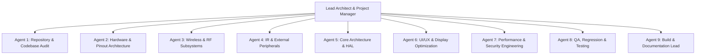

# GhostESP God Mode V2 – Master Engineering Project Plan

**Project:** Custom GhostESP Firmware on 7Semi ESP32-S3 Devkit  
**Version:** 2.0.0 (God Mode V2)  
**Lead Architect:** Principal Embedded Systems Architect & Autonomous Engineering Organization  
**Date:** November 24, 2026  

---

## 1. Engineering Organization & Workstream Allocation

GhostESP God Mode V2 is engineered by a coordinated autonomous engineering organization with distinct, specialized workstreams:

---

## 2. 10-Phase Engineering Lifecycle (SDLC)

### Phase 1: Requirements Analysis & Exhaustive Repository Audit
- **Objective:** Audit the complete repository structure, dependencies, build scripts, entry points, and existing features.
- **Key Deliverables:** `SRS.md`, `REPOSITORY_AUDIT.md`, `EXISTING_FEATURES.md`, `TECHNICAL_DEBT.md`.
- **Status:** In Progress (Agent 1 active).

### Phase 2: Technical Feasibility & Board Pinout Authority
- **Objective:** Establish the 7Semi ESP32-S3-WROOM-1-N16R8 hardware specification as the single hardware source of truth.
- **Key Deliverables:** `HARDWARE_COMPATIBILITY.md`, `PIN_CONFIGURATION.md`.
- **Status:** In Progress (Agent 2 active).

### Phase 3: Hardware Abstraction & Central Pin Registry
- **Objective:** Design and implement a centralized board configuration (`include/hardware/board_config.h` & `main/hardware/board_config.c`).
- **Features:** Dynamic peripheral registration, pin direction/lock state tracking, bus collision prevention (I2C vs SPI2 vs SPI3), and graceful missing-hardware handling.
- **Status:** In Progress.

### Phase 4: Development Planning & Centralized Task Tracking
- **Objective:** Structure work into clear, traceable milestones with assigned criteria.
- **Key Deliverables:** `PROJECT_PLAN.md`, `TASKS.md`, `CHANGELOG.md`.
- **Status:** Active.

### Phase 5: Wireless & RF Subsystems Fortification
- **Objective:** Deep audit and refactoring of Wi-Fi promiscuous frame sniffing, BLE GAP scanning, and NRF24 2.4 GHz spectrum sweep engine on dedicated `SPI2_HOST`.
- **Key Deliverables:** `WIRELESS_RF_SUBSYSTEM_REPORT.md`, refactored `wifi_manager.c`, `nrf24_remote_manager.c`, and `cmd_wifi.c`.
- **Status:** In Progress (Agent 3 active).

### Phase 6: IR & External Peripherals Modularization
- **Objective:** Modularize Infrared (RMT TX/RX protocol decoders), SD card SPI/SDMMC abstraction, and sensor drivers.
- **Key Deliverables:** `IR_AND_PERIPHERALS_REPORT.md`, updated `universal_ir.c`, `cmd_ir.c`, `sd_card_manager.c`.
- **Status:** In Progress (Agent 4 active).

### Phase 7: UI/UX Compact Screen Optimization (ST7735S 128×160)
- **Objective:** Ensure all LVGL UI views conform to compact screen tokens (`GUI_GRID=2`, `GUI_STATUS_BAR_H=22`, `GUI_CONTROL_H=24`), Montserrat 8/10 fonts, responsive menus, and zero text/button overflow.
- **Key Deliverables:** Sized views for Options View, Airspace Monitor, NRF24 Analyzer, Settings Screen.
- **Status:** Verified baseline; continuing refinement.

### Phase 8: Performance, FreeRTOS & Security Hardening
- **Objective:** Measure CPU utilization, enforce stack safety (min 4096 bytes on complex tasks), ensure external PSRAM allocation for buffers, eliminate blocking while-loops, and sanitize command line inputs.
- **Status:** Scheduled.

### Phase 9: QA, Regression Testing & Physical Hardware Validation
- **Objective:** Comprehensive testing of boot flow, peripheral presence detection, SPI/I2C buses, NRF24 analyzer, RGB modes, and TinyUSB BadUSB injection.
- **Key Deliverables:** `TESTING_REPORT.md`.
- **Status:** Scheduled.

### Phase 10: Build Artifact Generation & Final Delivery
- **Objective:** Complete firmware build (`idf.py build`), size accounting, artifact packaging, documentation refresh, and release tagging.
- **Key Deliverables:** `BUILD_GUIDE.md`, `TROUBLESHOOTING.md`, `CHANGELOG.md`, Final Delivery Report.
- **Status:** Scheduled.

---

## 3. Milestone Schedule & Verification Gates

| Milestone | Target Completion | Quality Gate / Acceptance Criteria | Status |
| :--- | :---: | :--- | :---: |
| **M1: Audit & Pin Authority** | Phase 1–3 | Complete repository audit and verified 7Semi pinout authority committed. | IN PROGRESS |
| **M2: HAL & Board Config** | Phase 3–4 | `board_config.h/.c` integrated into build system with zero compile warnings. | PENDING |
| **M3: Subsystems Hardening** | Phase 5–6 | Wi-Fi, BLE, NRF24, IR, and SD Card managers decoupled from hardcoded pins. | PENDING |
| **M4: UI & Performance Pass** | Phase 7–8 | 128×160 LVGL interface fully responsive, heap watermarks verified in PSRAM. | PENDING |
| **M5: Build & Final Acceptance**| Phase 9–10 | Clean compilation, test suite passed, firmware artifacts generated, all docs complete. | PENDING |
