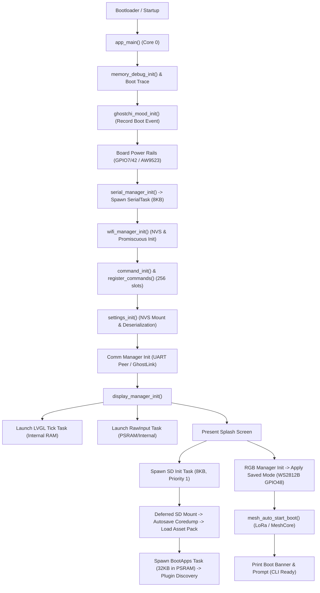

# Repository & Architecture Audit: Custom GhostESP Firmware

**Target Architecture:** ESP32-S3 (Xtensa Dual-Core LX7 @ 240 MHz + LP core)  
**Hardware Profile:** 7Semi ESP32-S3-WROOM-1-N16R8 (16 MB SPI Flash, 8 MB Octal PSRAM)  
**Framework Version:** Espressif IoT Development Framework (ESP-IDF) v6.1.1  
**Project Name:** `Ghost_ESP_IDF` / `Custom GhostESP Firmware`  
**Audit Date:** November 24, 2026  
**Auditor:** Agent 1 - Repository & Architecture Auditor (GhostESP God Mode V2)

---

## 1. Executive Summary

This document provides an exhaustive, deep architectural audit of the **Custom GhostESP Firmware** repository. The firmware represents a highly modular, multi-target offensive and defensive wireless security framework originally ported and expanded from Marauder and GhostESP architectures.

The codebase consists of over 180 source files spanning WiFi promiscuous frame injection and sniffing, Bluetooth Low Energy (BLE) scanning, spoofing, and spamming, 2.4 GHz RF spectrum analysis (NRF24L01+), Sub-GHz transceiver control (CC1101), LoRa/Meshtastic/MeshCore mesh networking, High Frequency (HF) NFC/RFID manipulation (PN532 & ST25R3916), BadUSB / BadBLE HID keystroke injection, infrared capture and replay, GPS wardriving, and an advanced graphical display manager powered by LVGL v8.

---

## 2. Repository Structure Breakdown

The repository follows a hybrid ESP-IDF component architecture. The primary application logic resides inside `main/` and its modular subdirectories, mirrored by `include/`, with platform-level drivers and external libraries isolated in `components/` and `managed_components/`.

```
Custom GhostESP Firmware/
├── .github/                      # CI/CD workflows (matrix builds across targets)
├── build/                        # Local compilation artifacts (git-ignored)
├── cmake/                        # Target-specific build utilities (e.g. crowpanel_rgb_factory.cmake)
├── components/                   # Project-local custom hardware & middleware components
│   ├── axs15231b/                # QSPI AMOLED/TFT display driver
│   ├── esp-idf-pn532/            # NXP PN532 NFC reader I2C/SPI/UART driver
│   ├── esp-idf-st25r3916/        # STMicroelectronics ST25R3916 NFC frontend
│   ├── esp32-camera/             # Omnivision/GalaxyCore camera driver
│   ├── esp_audio_codec/          # Audio decoding headers (FLAC, MP3, AAC, WAV)
│   ├── esp_driver_parlio/        # Parallel IO driver (backported/shimmed)
│   ├── esp_hal_parlio/           # Parallel IO hardware abstraction
│   ├── io_manager/               # AW9523, TCA95xx, CH422G I/O expander manager
│   ├── lua/                      # Lua 5.4 embeddable interpreter for GhostScript
│   ├── lvgl/                     # Light and Versatile Graphics Library v8.3.11
│   ├── lvgl_esp32_drivers/       # SPI/I80 display and I2C/SPI touch drivers for LVGL
│   ├── M5GFX/                    # M5Stack graphics engine (wrapper for LovyanGFX)
│   ├── mdns/                     # Multicast DNS networking component
│   └── tlv320dac3100/            # TI TLV320DAC3100 I2S audio DAC driver
├── configs/                      # Preconfigured board profiles (68 sdkconfig templates)
│   ├── sdkconfig.default.esp32   # ESP32 Classic baseline
│   ├── sdkconfig.default.esp32s3 # ESP32-S3 baseline (used for 7Semi N16R8)
│   ├── sdkconfig.default.esp32c3 # ESP32-C3 baseline
│   ├── sdkconfig.default.esp32c5 # ESP32-C5 dual-band baseline
│   ├── sdkconfig.default.esp32c6 # ESP32-C6 802.15.4 / Zigbee baseline
│   └── ...                       # Board profiles: Cardputer, T-Deck, T-Embed, CYD, etc.
├── docs/                         # Documentation, pinout tables, manuals
├── firmware/                     # Bundled binary blobs (e.g. CrowPanel C6 co-processor)
├── include/                      # Public C headers mirrored to main/
│   ├── core/                     # System, shell, command, version headers
│   ├── features/                 # WiFi & BLE attack definitions
│   ├── gui/                      # Design tokens, view models, router headers
│   ├── managers/                 # Subsystem manager interfaces
│   ├── scans/                    # Scanning and reconnaissance headers
│   └── vendor/                   # Third-party driver definitions
├── main/                         # Core application implementation
│   ├── core/                     # System management, CLI, serial, callbacks
│   │   ├── commands/             # Modular CLI command handlers (37 command files)
│   │   ├── callbacks.c           # Promiscuous packet handlers & wardriving dispatch
│   │   ├── commandline.c         # Command registry and parser
│   │   ├── serial_manager.c      # Dual UART / USB-Serial-JTAG console driver
│   │   ├── system_manager.c      # Task lifecycle management
│   │   ├── dns_server.c          # Captive portal DNS server & sinkhole
│   │   ├── sinkhole_https.c      # Intercepting TLS server
│   │   ├── esp_comm_manager.c    # GhostLink framed UART protocol (peer-to-peer)
│   │   └── memory_debug.c        # Heap tracing, watermark logging
│   ├── features/                 # Offensive security attack implementations
│   │   ├── ble/                  # BLE spam (Apple, Fast Pair, SwiftPair, Samsung)
│   │   ├── ethernet/             # ARP poisoning
│   │   └── wifi/                 # Beacon spam, Auth flood, Probe flood, SAE flood, Deauth
│   ├── gui/                      # Custom GUI engine on top of LVGL
│   │   ├── accessibility_fonts.c # Dynamic small/medium/large font scaler
│   │   ├── gui_router.c          # Screen stack router and transition manager
│   │   ├── main_menu_layout.c    # Circular/grid/paged app launcher
│   │   ├── theme_palette.c       # Dark, Matrix, Cyberpunk, AMOLED themes
│   │   └── lvgl_safe.c           # Thread-safe object and timer disposal
│   ├── managers/                 # State and hardware abstraction controllers
│   │   ├── display_manager.c     # Display pipeline, backlight, LVGL task, input dispatch
│   │   ├── wifi_manager.c        # WiFi stack controller, promiscuous modes, STA/AP
│   │   ├── ble_manager.c         # NimBLE host initialization, GAP scanner/advertiser
│   │   ├── ap_manager.c          # SoftAP and Evil Portal HTTP server engine
│   │   ├── badusb_manager.c      # TinyUSB composite HID keyboard/mouse injection
│   │   ├── badble_manager.c      # NimBLE HID over GATT keyboard injection
│   │   ├── hid_script_parser.c   # DuckyScript v1 parser and execution engine
│   │   ├── nrf24_remote_manager.c# NRF24L01+ 2.4 GHz spectrum analyzer driver
│   │   ├── subghz_remote_manager.c# CC1101 Sub-GHz spectrum, recording, playback
│   │   ├── lora_manager.c        # Semtech SX1262 LoRa / Meshtastic packet stack
│   │   ├── meshcore_manager.c    # Ed25519 MeshCore encrypted ad-hoc mesh
│   │   ├── infrared_manager.c    # RMT infrared transmitter, decoder, and TV-B-Gone
│   │   ├── nfc/                  # MIFARE Classic, NTAG, DESFire, Picopass, EMV
│   │   ├── sd_card_manager.c     # SDMMC and SPI FAT filesystem, JIT mount arbiter
│   │   ├── settings_manager.c    # NVS persistence engine with atomic backup
│   │   ├── ghostchi_manager.c    # Tamagotchi-like interactive companion pet
│   │   ├── ghostscript_runtime.c # Lua 5.4 sandboxed script environment
│   │   ├── plugin_manager.c      # Dynamic `.gapp` ELF application loader
│   │   ├── rgb_manager.c         # WS2812B NeoPixel RMT / SPI driver & animations
│   │   └── views/                # 42 graphical UI view implementations
│   ├── scans/                    # Reconnaissance routines
│   │   ├── ble/                  # Airtag, Skimmer, Flipper, GATT, and Advertisers
│   │   └── wifi/                 # AP scan, Station scan, Airspace, WPS, WPA3 compliance
│   ├── vendor/                   # Embedded drivers (RTC, PMU, IMU, Radiotap, PCAP)
│   └── main.c                    # System entry point (`app_main`)
├── managed_components/           # ESP Component Registry dependencies
│   ├── espressif__cjson/         # JSON parser
│   ├── espressif__elf_loader/    # Native executable relocator for SD apps
│   ├── espressif__esp_hosted/    # VHCI / SDIO host bridge for ESP32-P4 + C6
│   ├── espressif__esp_tinyusb/   # TinyUSB device stack for ESP32-S3
│   ├── espressif__usb/           # USB host base driver
│   ├── espressif__usb_host_hid/  # USB HID host driver (keyboard capture)
│   └── espressif__w5500/         # SPI Ethernet controller driver
├── ota_updater/                  # Lightweight secondary recovery updater
├── plugins/                      # Sample native `.gapp` plugin projects
├── scripts/                      # Build automation, Kconfig fixers, dictionary packers
├── webui/                        # Single-page web console (HTML/JS/CSS assets)
├── partitions.csv                # 4 MB factory layout (single app, no OTA)
├── partitions_ota_16mb.csv       # 16 MB dual-OTA layout (used by 7Semi S3 N16R8)
├── sdkconfig                     # Active build configuration
└── sdkconfig.defaults            # Project-wide Kconfig defaults
```

---

## 3. Entry Point & Initialization Sequence

### 3.1 Kernel Entry (`main/main.c:app_main()`)

Execution begins at `app_main(void)` running as a FreeRTOS task on Core 0 with an initial stack allocated by the ESP-IDF startup code.



### 3.2 Step-by-Step Initialization Sequence

1. **Pre-Allocation & Core Tracing:**
   - Releases Classic Bluetooth memory back to the system heap if compiled on ESP32 classic: `esp_bt_controller_mem_release(ESP_BT_MODE_CLASSIC_BT)`.
   - Initializes `memory_debug_init()` and starts recording the boot watermark trace.
   - Restores the virtual pet mood subsystem via `ghostchi_mood_init()`.

2. **Hardware Rail & Pin Deselection:**
   - Forces SPI CS pins for SD cards, displays, and peripheral transceivers high (`gpio_set_level(..., 1)`) to avoid bus contention during power-up transients.
   - On boards with power expanders (e.g. M5CoreS3-SE, AW9523), commands 5V boost converters on Grove ports.

3. **Serial & Console Subsystem (`serial_manager_init()`):**
   - Installs the primary console UART (`UART_NUM_0`) with 115200 baud and 1024-byte RX buffer.
   - Installs the Native USB-Serial/JTAG driver (`usb_serial_jtag_driver_install`) with 512-byte RX/TX buffers.
   - Spawns **`SerialTask`** (Priority 2, 8192 bytes stack) to handle line-buffering, history, ANSI cursor control, and command execution.

4. **Wireless Subsystems:**
   - `wifi_manager_init()`: Initializes L2 network structures, promiscuous packet filters, station configurations, and register event loops.
   - `ap_manager_init()`: Sets up the SoftAP structures and prepares the HTTP captive portal daemon.
   - If enabled by configuration: `badusb_manager_init()` registers TinyUSB endpoints, `badble_manager_init()` starts the NimBLE HID profile, and `lora_manager_early_init_off_main()` stages radio state.

5. **Command Registry & Settings:**
   - `command_init()`: Allocates a 256-command lookup table from PSRAM (`MALLOC_CAP_SPIRAM | MALLOC_CAP_8BIT`) or internal RAM fallback.
   - `register_commands()`: Registers over 90 core CLI commands.
   - `settings_init(&G_Settings)`: Mounts NVS partition `nvs`, loads persistent settings (SSIDs, attack preferences, pins, RGB modes, UI preferences), and sets system log levels.

6. **GhostLink Peer-to-Peer Bus (`esp_comm_manager_init()`):**
   - Configures expansion UART pins (`G_Settings.esp_comm_tx_pin`, `G_Settings.esp_comm_rx_pin`) with packet framing to communicate with secondary coprocessors or paired ESP32 devices.

7. **Display & GUI Subsystem (`display_manager_init()`):**
   - Initializes SPI3 / I80 / MIPI LCD controllers and touch controllers (ST7735S, ST7262, FT6336, etc.).
   - Allocates dual draw buffers for LVGL (sized to display width × 20-40 rows).
   - Starts **`LVGL Tick Task`** (Priority 5, 8192 bytes internal stack).
   - Starts **`RawInput`** task (Priority 6, 4096 bytes PSRAM stack) to poll physical buttons, encoders, or joysticks.
   - Transitions immediately to `splash_view` to render boot graphics and hold the screen while background initialization completes.

8. **Deferred Background Worker Tasks:**
   - Spawns **`SD Init`** task (Priority 1, 8192 bytes) to probe SD card over SPI or SDMMC without stalling the UI.
   - `SD Init` checks for crash coredumps in flash and autosaves them to `/mnt/ghostesp/logs/coredumps/`.
   - `SD Init` loads active GUI icon asset packs from `/mnt/ghostesp/assets/`.
   - Spawns **`BootApps`** task (Priority 5, 32768 bytes in PSRAM) to index and load native `.gapp` ELF plugins from `/mnt/ghostesp/apps/`.

9. **RGB LED & NeoPixel Initialization:**
   - Inspects `G_Settings` for RGB data pin configuration (GPIO48 on 7Semi S3).
   - Initializes RMT WS2812 driver via `rgb_manager_init()`.
   - Starts remembered RGB animation task (`rainbow_task` or `knightrider_task`) or restores saved static color.

10. **Auto-Start Radio Protocols & Ready Prompt:**
    - Checks NVS `mesh/mode` and auto-starts Meshtastic or MeshCore if configured.
    - Prints the ASCII boot banner, reports total free internal and Octal PSRAM heaps, and prints the interactive shell prompt `GhostESP> `.

---

## 4. FreeRTOS Task Architecture

The firmware relies heavily on FreeRTOS tasks to achieve non-blocking concurrency across network sniffing, RF sweeps, display rendering, and interactive CLI control.

### Comprehensive Task Roster

| Task Name | Function Entry | Stack Size | Priority | Core Affinity | Allocation Source | Lifecycle | Description |
| :--- | :--- | :--- | :--- | :--- | :--- | :--- | :--- |
| **`app_main`** | `app_main` | 8,192 B | 1 | Core 0 | System DRAM | Bootloader $\to$ Exit | System bootstrap coordinator |
| **`SerialTask`** | `serial_task` | 8,192 B | 2 | Any | Internal RAM / PSRAM | Permanent | Polling UART0 & USB-JTAG, executing CLI commands |
| **`LVGL Tick Task`** | `lvgl_tick_task` | 8,192 B | 5 | Core 1 / Any | Internal RAM | Permanent | Calls `lv_timer_handler()`, rendering GUI frames @ 50 Hz |
| **`RawInput`** | `hardware_input_task`| 4,096 B | 6 | Any | PSRAM Static / DRAM | Permanent | Polling hardware buttons, rotary encoders, touch drivers |
| **`EncPoll`** | `encoder_poll_task` | 2,048 B | 6 | Any | Dynamic DRAM | Permanent | Dedicated rotary encoder quadrature edge debouncer |
| **`SD Init`** | `deferred_sd_init_task`| 8,192 B | 1 | Any | Dynamic DRAM | Boot Only | Deferred SD mount, coredump flush, asset pack loading |
| **`BootApps`** | `boot_app_discovery_task`| 32,768 B | 5 | Any | PSRAM Static | Boot Only | Scans SD card, decompresses `.gapp` ELF binaries |
| **`pcap_wr`** | `pcap_writer_task` | 3,072 B | 5 | Any | PSRAM / DRAM | On-Demand | Drains promiscuous capture ringbuffer to SD `.pcap` |
| **`wd_obs`** | `wardrive_obs_task` | 4,096 B | 3 | Any | Static PSRAM/DRAM | On-Demand | Aggregates GPS + BSSID observations for WiGLE CSV |
| **`dns_server`** | `dns_server_task` | 5,120 B | 5 | Any | Dynamic DRAM | On-Demand | Responds to DNS queries, redirecting clients to Captive Portal |
| **`dns_sinkhole`**| `dns_server_task` | 5,120 B | 5 | Any | PSRAM / DRAM | On-Demand | Domain blacklisting & sinkhole DNS responder |
| **`comm_rx_task`** | `rx_task` | 4,096 B | 5 | Any | Static DRAM | Permanent | GhostLink UART framing receiver and command parser |
| **`Rainbow Task`** | `rainbow_task` | 4,096 B | 2 | Core 1 | Dynamic DRAM | On-Demand | RGB LED rainbow color-cycling animation |
| **`Knight Rider`** | `knightrider_task` | 4,096 B | 2 | Any | Dynamic DRAM | On-Demand | RGB LED single/multi-pixel red breathing pulse |
| **`Police Task`** | `police_task` | 4,096 B | 2 | Any | Dynamic DRAM | On-Demand | Alternating rapid Red/Blue strobe bursts |
| **`Strobe Task`** | `strobe_task` | 4,096 B | 2 | Any | Dynamic DRAM | On-Demand | 10 Hz high-intensity white strobe effect |
| **`nrf24_sweep`** | `nrf24_task` | 4,096 B | 3 | Any | Dynamic DRAM | On-Demand | Sweeps 126 channels on NRF24L01+, streaming RSSI |
| **`subghz_task`** | `subghz_task` | 4,096 B | 3 | Any | Dynamic DRAM | On-Demand | Polling CC1101 RSSI waterfall / carrier detection |
| **`subghz_rx_raw`**| `subghz_rx_raw_task`| 8,192 B | 5 | Any | Dynamic DRAM | On-Demand | High-speed GPIO interrupt capture of Sub-GHz OOK pulses |
| **`badusb_exec`** | `badusb_exec_task` | 8,192 B | 5 | Any | Dynamic DRAM | On-Demand | Parses and executes DuckyScript commands over USB |
| **`badble_exec`** | `badble_exec_task` | 8,192 B | 5 | Any | Dynamic DRAM | On-Demand | Parses and executes DuckyScript commands over BLE GATT |
| **`mouse_jiggle`** | `mouse_jiggler_task` | 4,096 B | 5 | Any | Dynamic DRAM | On-Demand | Randomly injects USB mouse cursor jitter |
| **`ble_bridge`** | `bridge_task` | 4,096 B | 4 | Any | Static DRAM | On-Demand | Bridges UART AT-commands to BLE GATT characteristics |
| **`ble_prph`** | `nimble_host_task` | 4,096 B | 4 | Core 0 | Static DRAM | On-Demand | Runs the Apache NimBLE Bluetooth LE stack loop |
| **`port_scan`** | `port_scan_subnet_task`| 8,192 B | 5 | Any | PSRAM / DRAM | On-Demand | TCP SYN/Connect scanner across local subnet |
| **`arp_scan`** | `arp_scan_task` | 8,192 B | 5 | Any | PSRAM / DRAM | On-Demand | Broadcasts ARP requests and tabulates alive IP/MAC pairs |
| **`enum_scan`** | `enum_scan_task` | 8,192 B | 5 | Any | PSRAM / DRAM | On-Demand | NetBIOS / SMB / RPC info gathering scanner |
| **`local_scan`** | `local_scan_task` | 10,240 B | 5 | Any | PSRAM / DRAM | On-Demand | Full active subnet discovery with reverse DNS lookup |
| **`deauth_task`** | `deauth_task` | 3,072 B | 5 | Any | PSRAM / DRAM | On-Demand | Raw 802.11 deauthentication frame injector |
| **`beacon_task`** | `beacon_spam_task` | 4,096 B | 5 | Any | PSRAM / DRAM | On-Demand | 802.11 beacon spam burst generator |
| **`auth_flood`** | `auth_flood_task` | 4,096 B | 5 | Any | PSRAM / DRAM | On-Demand | 802.11 authentication frame exhaustion attack |
| **`probe_flood`** | `probe_flood_task` | 4,096 B | 5 | Any | PSRAM / DRAM | On-Demand | 802.11 directed/wildcard probe request generator |
| **`sae_flood`** | `sae_flood_task` | 4,096 B | 5 | Any | PSRAM / DRAM | On-Demand | WPA3 Dragonfly handshake commit/confirm flood |
| **`karma_task`** | `karma_task` | 4,096 B | 5 | Any | Dynamic DRAM | On-Demand | Listens for probe requests and dynamically advertises SSIDs |
| **`airtag_scan`** | `airtag_scanner_task` | 4,096 B | 4 | Any | Dynamic DRAM | On-Demand | Filters BLE advertisements matching Apple FindMy payload |
| **`gps_info`** | `gps_info_task` | 3,072 B | 1 | Any | Static DRAM | On-Demand | Continuous NMEA sentence parsing & coordinate display |
| **`mem_monitor`** | `memory_debug_monitor_task`| 3,072 B | 1 | Any | Dynamic DRAM | Permanent | Periodic memory leak / heap fragmentation telemetry |

---

## 5. Build Configuration & Compilation Architecture

### 5.1 CMake Orchestration
The root `CMakeLists.txt` controls global compiler flags, ESP-IDF target alignment, partition table selection, and git build metadata:

- **Linker Defs:** `-Wl,-z,muldefs` allows overriding weak default implementations across components.
- **Kconfig Auto-Alignment:** Executes `scripts/prepare_idf_wifi_kconfig.py` at configure time to align Wi-Fi cache TX buffer definitions between ESP-IDF 6.1 defaults and GhostESP profiles.
- **Git Metadata Injection:** Automatically queries `git rev-parse --short HEAD` and `git rev-list --count HEAD` at build time, injecting `GIT_COMMIT_HASH`, `GIT_BRANCH`, and `GHOSTESP_BUILD_NUMBER` macros.
- **Target Feature Detection:** Evaluates `IDF_TARGET` (e.g. `esp32s3`, `esp32c5`, `esp32p4`). On `esp32s2`, BLE source files are stripped via regex filters before compilation.

### 5.2 Component Build System (`main/CMakeLists.txt`)
- **Source Globbing:** Employs `file(GLOB_RECURSE app_sources ...)` while filtering out target-incompatible files (e.g. Flipper NFC parsers are whitelisted individually to conserve flash).
- **Conditional Components:**
  - `esp_tinyusb` and `usb_host_hid` are included exclusively for ESP32-S3 builds.
  - `esp_hosted` and `esp_wifi_remote` are attached only for ESP32-P4 targets bridging through an onboard ESP32-C6.
  - `ieee802154` is included for ESP32-C5 / C6 builds.
  - `tlv320dac3100` and `esp_audio_codec` are linked for audio-capable platforms.
- **Embedded Binary Assets:** Employs `EMBED_FILES` to link binary payloads directly into flash:
  - `core/ouis.bin`: Binary database of IEEE MAC Organizationally Unique Identifiers for vendor resolution.
  - `mf_classic_dict_packed.bin`: Compressed dictionary of standard MIFARE Classic cryptographic keys.

### 5.3 Automated Multi-Target Builder (`build.py`)
`build.py` provides cross-platform compilation management:
- Automatically downloads and validates matching ESP-IDF release toolchains if not present.
- Reads `configs/sdkconfig.*` to build artifacts for any of the 68 supported hardware configurations.
- Calls `esptool.py` to merge `bootloader.bin`, `partition-table.bin`, `ota_data.bin`, and application binaries into a single, unified flashable image.

---

## 6. Memory Configuration & Subsystem Architecture

### 6.1 Hardware Memory Layout (ESP32-S3-WROOM-1-N16R8)

| Memory Region | Physical Size | Bus Architecture | Operating Speed | Notes |
| :--- | :--- | :--- | :--- | :--- |
| **SRAM0 / SRAM1** | 512 KB | Internal 32-bit Bus | 240 MHz | ~380 KB usable after ROM/DMA reserved |
| **RTC Fast/Slow RAM** | 16 KB | Low Power Core Bus | 8 MHz / 150 kHz | Holds deep-sleep wake stubs & RTC state |
| **Octal PSRAM (SPIRAM)** | 8,192 KB (8 MB) | Octal SPI (OPI) DTR | 40 MHz (Configured) | AP_3v3 embedded, mapped via MMU cache |
| **SPI Flash** | 16,384 KB (16 MB) | Quad SPI (DIO) | 80 MHz | Holds bootloader, partition table, apps, NVS |

### 6.2 PSRAM & Heap Allocation Rules
In `sdkconfig`:
- `CONFIG_SPIRAM=y`
- `CONFIG_SPIRAM_MODE_OCT=y`
- `CONFIG_SPIRAM_USE_MALLOC=y`: Standard `malloc()` calls above `CONFIG_SPIRAM_MALLOC_ALWAYSINTERNAL=16384` (16 KB) automatically allocate from Octal PSRAM.
- `CONFIG_SPIRAM_MALLOC_RESERVE_INTERNAL=32768`: Enforces that at least 32 KB of internal DRAM is permanently reserved for DMA buffers and interrupt-context routines.
- `CONFIG_SPIRAM_ALLOW_STACK_EXTERNAL_MEMORY=y`: Permits task stacks to be placed in PSRAM via `xTaskCreateStatic()` or `xTaskCreateWithCaps()`. Tasks doing heavy recursion, GUI decompression, or ELF loading (e.g. `BootApps` with 32 KB) allocate their stacks from PSRAM, preserving scarce internal DRAM.

### 6.3 Partition Tables & Flash Budget

The repository includes multiple partition layouts tailored to specific hardware configurations:

#### Active 16 MB Dual-OTA Layout (`partitions_ota_16mb.csv`):
```csv
# Name,     Type, SubType,  Offset,   Size,     Flags
nvs,        data, nvs,      0x9000,   0x7000,
otadata,    data, ota,      0x10000,  0x2000,
ota_0,      app,  ota_0,    0x20000,  0x600000,   # 6,291,456 bytes (6.0 MB)
ota_1,      app,  ota_1,    0x620000, 0x600000,   # 6,291,456 bytes (6.0 MB)
coredump,   data, coredump, 0xC20000, 0x20000,   # 131,072 bytes (128 KB)
```
- **Total Flash Utilized:** ~12.25 MB.
- **Remaining Headroom:** ~3.75 MB spare flash space available at the upper end of the 16 MB chip for storage partitions (e.g. LittleFS or FAT wear-levelling).

#### 4 MB Single App Layout (`partitions.csv`):
```csv
# Name,     Type, SubType,  Offset,   Size,     Flags
nvs,        data, nvs,      0x9000,   0x7000,
app0,       app,  factory,  0x10000,  0x3E0000,   # 4,063,232 bytes (3.87 MB)
coredump,   data, coredump, 0x3F0000, 0x10000,   # 65,536 bytes (64 KB)
```
> [!NOTE]
> If building for a 16 MB board using `partitions.csv` instead of `partitions_ota_16mb.csv`, the upper 12 MB of flash remains unpartitioned and unused. The build configuration in `configs/sdkconfig.default.esp32s3` points to `partitions_ota_16mb.csv` for 16 MB targets.

---

## 7. Audit Verification & Status Matrix

| Subsystem | Source Location | Hardware Dependency | Health Status | Architectural Notes |
| :--- | :--- | :--- | :--- | :--- |
| **Boot & Init** | `main/main.c` | Core ESP32-S3 | **EXCELLENT** | Deterministic RAM measurement around every init call |
| **Serial Shell** | `main/core/serial_manager.c`| UART0 / USB-JTAG | **EXCELLENT** | Dual-console input serialization, history, editing |
| **Command Engine** | `main/core/commandline.c` | Core System | **EXCELLENT** | 256-command dynamic pool, case-insensitive lookup |
| **Display / LVGL**| `main/managers/display_manager.c`| ST7735S / SPI3 | **STABLE** | Safe callback dispatching, auto-scaling tokens |
| **RGB Subsystem** | `main/managers/rgb_manager.c`| WS2812B / GPIO48 | **STABLE** | Sine breathing on 1-LED boards, live dimming |
| **RF Analyzer** | `main/managers/nrf24_remote_manager.c`| NRF24L01+ / SPI2 | **STABLE** | Continuous sweep across 126 channels, CE latching |
| **WiFi Engine** | `main/managers/wifi_manager.c`| ESP32-S3 Radio | **STABLE** | Promiscuous injection & capture, channel hopping |
| **Storage & SD** | `main/managers/sd_card_manager.c`| SPI / SDMMC | **STABLE** | JIT bus arbitration, crash coredump autosave |
| **Mesh Networking**| `main/managers/lora_manager.c`| SX1262 (Optional) | **MODULAR** | Auto-start deferred to avoid boot DRAM exhaustion |
