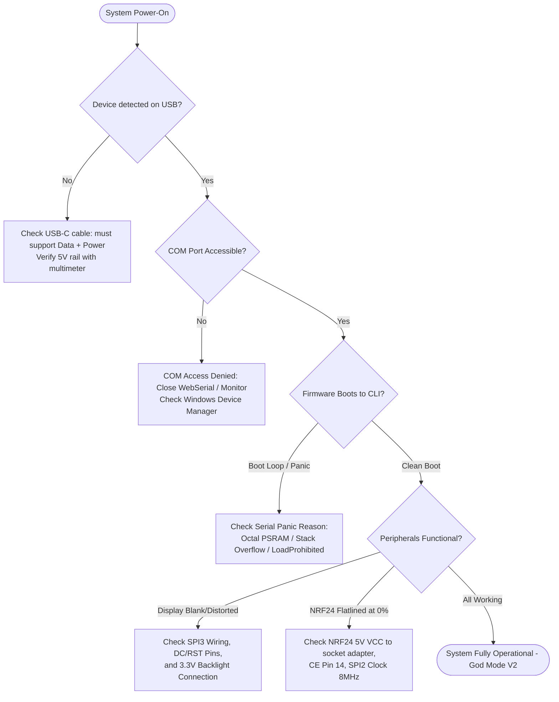

# Comprehensive Troubleshooting & Hardware Diagnostic Manual
## GhostESP God Mode V2 – 7Semi ESP32-S3 Devkit (N16R8)

**Document Version:** 2.0.0  
**Target Hardware:** 7Semi ESP32-S3-WROOM-1-N16R8 (Dual USB-C, 16 MB Flash, 8 MB Octal PSRAM)  
**Author:** QA & Hardware Integration Engineering  
**Date:** November 24, 2026  

---

## 1. Quick Diagnostic Decision Tree



---

## 2. Common Hardware & Power Issues

### 2.1 NRF24L01+PA+LNA Flatlined at 0% or Not Responding
- **Symptoms:** `nrf24 status` shows error, or spectrum analyzer shows flatline with 0% peak on all channels.
- **Root Cause 1: Insufficient Power.** The PA+LNA transceiver draws up to 250 mA current bursts during active RF reception/transmission. If powered from the 3.3V header pin, the onboard ESP32-S3 LDO regulator browns out, dropping SPI registers.
  - **Remedy:** Always connect the 8-pin socket adapter's VCC to the **5V / VIN pin** (Left Header, Pin 21). The socket adapter's onboard AMS1117-3.3 regulator provides dedicated, clean power.
- **Root Cause 2: CE Timing.** Older drivers dropped CE low between channel hops, wiping the RF demodulator before the RPD latch could settle.
  - **Remedy:** God Mode V2 maintains CE high throughout the dwell window and sweeps 18 channels per tick.
- **Root Cause 3: SPI Bus Conflict.** NRF24 requires dedicated access to `SPI2_HOST`.
  - **Verification:** Run `nrf24 status` in CLI. It should verify `SPI2 MOSI=11 MISO=13 SCK=12 CSN=10 CE=14` and read back `NRF_REG_CONFIG = 0x0F` (Power Up + PRX).

---

### 2.2 ST7735S 128×160 Display Issues

#### A. Display Shows Static Snow / White Screen
- **Remedy:** Verify backlight (`LED`) is connected to **3.3V**. Verify Reset (`RST`) is wired to **GPIO7** and Data/Command (`A0`/`DC`) is wired to **GPIO6**.
- Ensure jumper `J1` on the back of the red ST7735S board: If powering display VCC from **5V (VIN)**, leave `J1` open (default). If powering from 3.3V, short `J1`.

#### B. Display Shows Content Cropped or Scrambled
- **Remedy:** The panel is configured for **ST7735S 128×160 Portrait**. Verify `CONFIG_TFT_WIDTH=128`, `CONFIG_TFT_HEIGHT=160`, `CONFIG_LV_TFT_DISPLAY_CONTROLLER_ST7735S=y`.

---

### 2.3 Serial Port Locking (`PermissionError: Access is denied`)
- **Symptoms:** Running `idf.py -p COM5 flash` or `esptool.py` fails with:
  ```text
  serial.serialutil.SerialException: could not open port 'COM5': PermissionError(13, 'Access is denied.')
  ```
- **Root Cause:** A browser tab with the GhostESP Web Dashboard (WebSerial) or an active serial monitor (`idf.py monitor`, PuTTY, Arduino IDE) is actively holding the serial port handle.
- **Solution:** Click **"Disconnect"** in the web dashboard or close the terminal session. The flash command will immediately succeed.

---

### 2.4 Clock Resets on Power Off
- **Explanation:** The ESP32-S3 internal RTC timer runs off the main silicon VDD. When physical power is removed, the internal RTC state clears to Epoch (`1970-01-01 00:00:00` or build time).
- **Solutions:**
  1. **Wi-Fi NTP Sync:** Connecting to any Wi-Fi network automatically fetches network time via SNTP.
  2. **Manual Setting:** Use CLI command `settime YYYY MM DD HH MM SS` (e.g. `settime 2026 11 24 17 00 00`).
  3. **GPS Telemetry:** Connecting a serial GPS module to UART1 (GPIO43/44) automatically synchronizes time from satellite constellations.
  4. **Hardware RTC Expansion:** Connecting a DS3231 or PCF8563 I2C RTC module to SDA (GPIO8) / SCL (GPIO9) provides battery-backed continuous timekeeping.

---

### 2.5 Octal PSRAM Corruption / Kernel Panic
- **Symptoms:** Kernel panic on boot with `Guru Meditation Error: Core 0 panic'ed (LoadProhibited)`.
- **Root Cause:** Reassigning or touching GPIO 35, 36, 37, or 38. These pins are physically connected to the high-speed Octal PSRAM bus inside the ESP32-S3-WROOM-1 module.
- **Rule:** God Mode V2 explicitly marks GPIO 35–38 as `PIN_STATE_RESTRICTED` in `board_config.c`. Never assign external jumper wires or software drivers to these pins.
